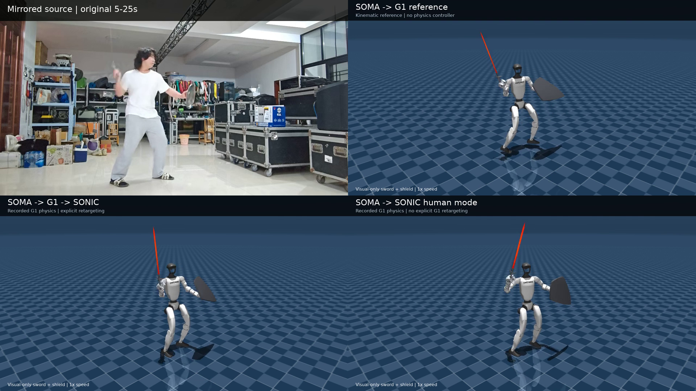

# Video2Motion

An auditable, detector-pluggable **video → articulated motion** pipeline with
SOMA/BVH outputs and optional humanoid-robot adapters.

Video2Motion separates motion extraction from the character or robot that will
consume it. The core stops at a portable joint hierarchy and world-space motion;
Unitree G1 and NVIDIA SONIC are included only as the first downstream example.



[`g1_adapter_demo.mp4`](media/g1_adapter_demo.mp4) shows the bundled G1 adapter demo:
pre-retargeted G1 tracking on the left and direct SONIC human-reference tracking
on the right. It is an example, not the definition of the project.

## Architecture

```text
owned video + explicit person boxes
                  │
                  ▼
          GEM-X native SOMA77
                  │
                  ▼
       world transforms + hierarchy
          ┌───────┼───────────┐
          ▼       ▼           ▼
         BVH   Blender/DCC   adapters/*
                              ├── G1 / SOMA Retargeter
                              └── SONIC human reference
```

The reusable core contains:

- hash-bound, sparse manual person boxes and per-frame interpolation;
- a detector-free GEM-X wrapper that refuses to load HumanArt/YOLOX;
- validated world-transform motion sequences with joint names, parents and FPS;
- FK-correct SOMA → BVH export with a numerical round-trip check;
- causal 30→50 Hz timestamp publishing that proves it never releases a future
  source frame;
- revision-pinned official model downloads with SHA-256 verification.

Robot-specific logic lives under [`adapters/`](adapters/). Adding another robot
does not require changing video extraction.

## What is deliberately absent

- No pretrained weights are mirrored. The downloader uses NVIDIA's official
  repositories and preserves their licenses and model cards.
- No GVHMR, SMPL, SMPL-X or GMR dependency.
- No HumanArt-trained person-detector weight.
- No private source footage, local filesystem paths, caches or old experiment
  history.

## Installation

The reference extraction environment used CUDA on Linux/WSL:

```bash
git clone https://github.com/NVlabs/GEM-X third_party/GEM-X
git -C third_party/GEM-X checkout 20555befe2fbbe5b2015e1fff7ff214dc18ea9d6

python -m venv .venv
source .venv/bin/activate
python -m pip install -e '.[download,test]'
python scripts/download_models.py --output weights
```

The downloader fetches only these fixed model revisions:

- [`nvidia/GEM-X`](https://huggingface.co/nvidia/GEM-X):
  `4fce057963671fd95cd4154297944397e7b5a9a0`
- [`nvidia/GEAR-SONIC`](https://huggingface.co/nvidia/GEAR-SONIC):
  `6733128a3d8a523b1418b06bca3cdf61c8b0987f`

GEM-X also needs the official SOMA geometry/runtime assets. Follow its
[installation guide](https://github.com/NVlabs/GEM-X/blob/main/docs/INSTALL.md).

## Extract motion

Create a run directory:

```text
runs/my_clip/
├── inputs/
│   ├── selected.mp4
│   └── manual-boxes.json
├── metrics/
├── processed/
└── raw/
```

`manual-boxes.json` contains sparse `[frame, x1, y1, x2, y2]` keyframes plus
the exact input hash, frame count and dimensions. See
[`examples/manual-boxes.example.json`](examples/manual-boxes.example.json).

```bash
python scripts/run_gemx_manual_boxes.py \
  --run runs/my_clip \
  --gemx-root third_party/GEM-X \
  --config configs/gemx_manual_native77.yaml \
  --soma-assets /path/to/soma-assets

python scripts/export_soma_bvh.py \
  --input runs/my_clip/raw/gemx_motion.pt \
  --run runs/my_clip \
  --gemx-root third_party/GEM-X \
  --soma-assets /path/to/soma-assets
```

The portable outputs are:

- `processed/soma_world_transforms.npz`: meters, 4×4 world transforms, joint
  hierarchy and sample rate;
- `processed/soma_bvh/selected.bvh`: standard BVH in centimeters/degrees;
- `metrics/soma-bvh-export.json`: provenance and FK round-trip error.

Consumers can use either portable output without importing the G1 adapter.

## Optional G1 / SONIC adapter

See [`adapters/g1/README.md`](adapters/g1/README.md). It pins:

```bash
git clone https://github.com/NVIDIA/soma-retargeter third_party/soma-retargeter
git -C third_party/soma-retargeter checkout cbdb2b494a2af82137bf9b6f15122d60167281c4

git clone https://github.com/NVlabs/GR00T-WholeBodyControl third_party/sonic
git -C third_party/sonic checkout 45c03facbf848e0c743091b7d9c17952096ff908

python scripts/download_models.py --only sonic --output weights
```

The example retains three synchronized 30 Hz trajectories in
`examples/g1_three_routes_30fps.npz`: kinematic G1 reference, SONIC tracking
of that reference, and direct SONIC tracking of a SOMA-derived human reference.

## “Real-time” boundary

Video extraction is currently offline and may inspect the complete clip.
Timestamp gating only proves controller-input causality; it does not make the
visual estimator online. For real teleoperation, replace the extractor with a
current-pose stream from VR, inertial mocap or an exoskeleton and retain the same
adapter contract. See [`docs/REALTIME.md`](docs/REALTIME.md).

The official low-latency SONIC policy still has its trained reference window.
The direct example supplies six zero wrist-reference channels because video has
no G1 wrist encoder channels; that is not a mechanical wrist lock.

## Verification

```bash
pytest
python scripts/validate_release.py
```

The release audit rejects model binaries, private paths and oversized files.

## Licensing

Video2Motion code is Apache-2.0. NVIDIA-derived code retains its notice. Model
weights and upstream assets remain under their own terms; see
[`THIRD_PARTY.md`](THIRD_PARTY.md). This is engineering documentation, not legal
advice.
